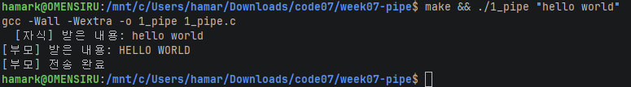
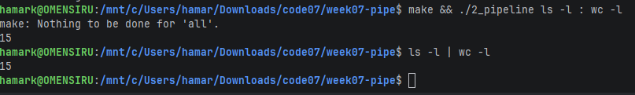
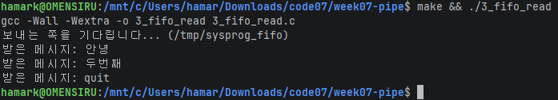
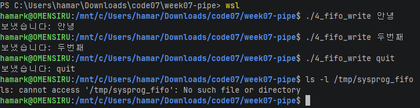

# 시스템프로그래밍 7주차 과제 — IPC (파이프 · FIFO)

| 파일 | 원본 | 내용 |
|---|---|---|
| `1_pipe.c` | `original/1_pipe_basic.c` | `./1_pipe "hello world"` — 부모가 보낸 문자열을 자식이 대문자로 바꿔 돌려줌 |
| `2_pipeline.c` | `original/2_pipe_dup2.c` | `./2_pipeline ls -l : wc -l` — `:` 로 나눈 두 명령을 파이프로 연결 |
| `3_fifo_read.c` / `4_fifo_write.c` | `original/3_fifo_read.c` / `4_fifo_write.c` | FIFO 로 메시지 주고받기 |

## 빌드 / 실행 (WSL2)

```bash
make
./1_pipe "hello world"
./2_pipeline ls -l : wc -l
./3_fifo_read          # 터미널 A
./4_fifo_write 안녕    # 터미널 B
```

## 1. 파이프 두 개로 문자열 왕복

(설명)



## 2. dup2 로 명령 이어 붙이기

(설명)



## 3. FIFO 로 메시지 주고받기

(설명)




---

## AI 활용 내용

### 사용한 도구와 프롬프트

### AI 가 한 것

### 내가 한 것

### 이번 과제를 하면서 이해한 내용
